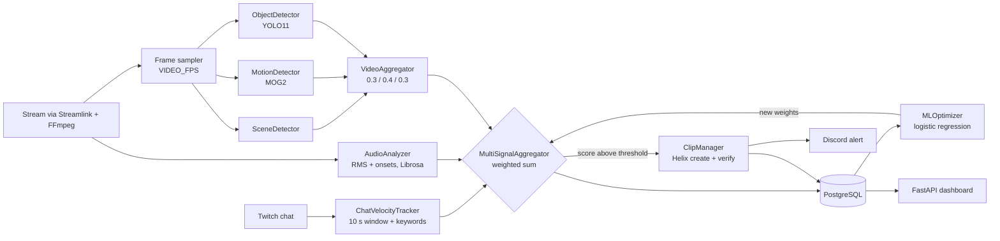

<p align="center">
  
</p>

<p align="center">
  <b>Watches a Twitch channel in real time, fuses chat, audio and video signals into one score, and creates a clip when it crosses a threshold.</b>
</p>

<p align="center">
  
  
  
  
  
  
</p>

---

## Overview

Streamers produce hours of content, and the moments worth clipping last seconds. A single heuristic such as chat speed misses quiet plays and fires on spam. This bot combines several independent signals from the live stream into one weighted score and calls the Twitch Helix API to create a clip when that score is high enough. Every decision is logged to PostgreSQL, so weights can later be re-fitted from real clip performance.

## Highlights

- **Four signal sources**: chat velocity and hype keywords (TwitchIO), audio RMS and onset count (Librosa), and a video score built from scene change, motion and YOLO11 object detection.
- **Weighted fusion** in a single `MultiSignalAggregator`, with a configurable threshold and a per-clip cooldown.
- **Live stream ingestion** through Streamlink and FFmpeg, with retry logic when the stream is offline.
- **Weight re-training**: a scikit-learn logistic regression fits new weights from logged signals and clip view counts (needs at least 50 samples).
- **Clip creation and verification** through the Twitch Helix `clips` endpoint, plus later view-count polling.
- **Operations layer**: FastAPI analytics dashboard, optional Discord webhook alerts, GPU-ready Docker image with a Postgres service.

## How it works



The score is evaluated on every incoming chat message. Each signal is normalised to the 0..1 range and combined with the default weights below; a clip is requested when the final score is strictly greater than `COMBINED_SCORE_THRESHOLD`.

| Signal | Normalisation | Default weight |
|---|---|---|
| Chat velocity (messages in 10 s) | `min(v / 100, 1)` | 0.4 |
| Audio RMS | `min(rms * 10, 1)` | 0.2 |
| Audio onsets | `min(n / 10, 1)` | 0.1 |
| Video score | already 0..1 | 0.2 |
| Hype keywords | `min(k / 5, 1)` | 0.1 |

The video score is itself a weighted sum: scene change 0.3, motion area 0.4, action 0.3. "Action" is true when YOLO sees at least `YOLO_ACTION_PERSON_COUNT` people (default 3) or any object in a small class set (COCO ids 39, 41, 43).

| Component | File | Role |
|---|---|---|
| Bot loop | `app/services/twitch_bot.py` | Receives chat, gathers signals, triggers clips |
| Chat tracker | `app/models/highlight.py` | Sliding-window message rate and keyword count |
| Audio | `stream_capture.py`, `audio_analyzer.py` | FFmpeg PCM capture, RMS and onset detection |
| Video | `video_capture.py`, `scene_detector.py`, `motion_detector.py`, `object_detector.py`, `video_aggregator.py` | Frame sampling and per-frame analysis |
| Fusion | `signal_aggregator.py` | Weighted score and clip decision |
| Clips | `clip_manager.py` | Helix create, verify, view counts, cooldown |
| Learning | `ml_optimizer.py` | Re-fits weights from stored signals |
| Persistence | `app/models/database.py`, `database_manager.py` | SQLAlchemy models: clips, signals, triggers, statistics |
| Dashboard | `app/api/dashboard.py` | FastAPI endpoints, Jinja template, Chart.js UI |
| Monitoring | `monitoring.py` | Counters and Discord webhook alerts |

Files without a directory live in `app/services/`.

## Tech stack

| Layer | Tools |
|---|---|
| Language and API | Python 3.11, FastAPI, Uvicorn, aiohttp |
| Twitch | TwitchIO 2.10.0, Helix REST API |
| Stream ingestion | Streamlink 7.0.0, FFmpeg |
| Audio | Librosa, SoundFile, NumPy |
| Video | OpenCV, Ultralytics YOLO11, PyTorch |
| ML | scikit-learn (logistic regression) |
| Storage | PostgreSQL 16, SQLAlchemy 2 |
| Deploy | Docker (CUDA 12.1 runtime image), Docker Compose |

## Quick start

Prerequisites: Python 3.11+, FFmpeg, a PostgreSQL instance, and Twitch API credentials from the [developer console](https://dev.twitch.tv/console/apps). An NVIDIA GPU is optional; YOLO falls back to CPU.

```bash
git clone https://github.com/Vladshmalii/twitch-auto-clip-bot.git
cd twitch-auto-clip-bot
pip install -r requirements.txt
cp .env.example .env        # fill in Twitch credentials, channel and DATABASE_URL
python app/main.py
```

Tables are created automatically on startup (`Base.metadata.create_all`). The dashboard is served on http://localhost:8000.

With Docker (the compose file requests an NVIDIA GPU, so the NVIDIA container toolkit is needed):

```bash
docker-compose up -d
docker-compose logs -f bot
```

## Configuration

Settings are loaded by `app/core/config.py` (pydantic-settings) from `.env`. Variables read by the code and shown in `.env.example`:

| Variable | Example value | Meaning |
|---|---|---|
| `TWITCH_CLIENT_ID`, `TWITCH_CLIENT_SECRET` | placeholder | Twitch application credentials |
| `TWITCH_ACCESS_TOKEN` | `oauth:...` | User token used for chat and clip creation |
| `CHANNEL_NAME` | `xqc` | Channel to watch |
| `DATABASE_URL` | PostgreSQL URL | SQLAlchemy connection string |
| `CHAT_VELOCITY_THRESHOLD` | `50` | Defined in settings; the fusion step uses its own normalisation |
| `COMBINED_SCORE_THRESHOLD` | `0.7` | Fused score required to clip |
| `CLIP_COOLDOWN_SECONDS` | `10` | Minimum gap between clips |
| `ENABLE_AUDIO_ANALYSIS` | `true` | Toggle the audio pipeline |
| `ENABLE_VIDEO_ANALYSIS` | `true` | Toggle the video pipeline (code default is `false`) |
| `YOLO_MODEL_SIZE` | `n` | YOLO11 size suffix (`n`, `s`, `m`, `l`, `x`) |
| `MOTION_THRESHOLD` | `5000` | Motion area considered high |
| `DISCORD_WEBHOOK_URL` | placeholder | Optional alert webhook |
| `ANALYTICS_UPDATE_INTERVAL` | `300` | Seconds between view and stats refresh |

Further tunables that exist in `Settings` but not in `.env.example`: `AUDIO_WINDOW_SECONDS`, `AUDIO_SAMPLE_RATE`, `VIDEO_FPS`, `VIDEO_FRAME_BUFFER_SIZE`, `SCENE_THRESHOLD`, `YOLO_CONFIDENCE`, `YOLO_ACTION_PERSON_COUNT`, `ML_TRAINING_DAYS`, `ML_SUCCESS_VIEW_THRESHOLD`.

## API endpoints

`GET /` (dashboard), `GET /health`, and under `/api/stats/`: `overview`, `trigger-effectiveness`, `daily-trends`, `signal-correlation`, `hourly-distribution`, `recent-signals`.

## Project structure

```
app/
  main.py                 entry point: dashboard thread + bot thread
  api/dashboard.py        FastAPI endpoints
  core/config.py          settings
  models/                 SQLAlchemy models, chat velocity tracker
  services/               capture, analyzers, fusion, clips, ML, monitoring
static/  templates/       dashboard UI
tests/                    placeholder package
Dockerfile  docker-compose.yml  requirements.txt
```

## Testing

No automated tests exist yet: `tests/test_bot.py` is an empty file.

## Status and roadmap

A working prototype, not a validated product. The fusion weights and normalisation constants are hand-set heuristics, and no precision or recall has been measured against labelled highlights.

- Add unit tests for the aggregator, chat tracker and normalisation, then integration tests with recorded streams.
- Alembic exists as a directory only (empty `env.py`, no `alembic.ini`); schema is created with `create_all`, so there are no migrations.
- `.env.example` lists `AUDIO_RMS_THRESHOLD`, `SCENE_CHANGE_THRESHOLD`, `CLIP_VERIFICATION_DELAY`, `VIDEO_FRAME_RATE` and `MONITORING_INTERVAL`, which `Settings` does not read (the frame rate field is `VIDEO_FPS`). Align the example file with the code.
- Replace the default Postgres password in `docker-compose.yml` with an environment-provided value.
- Label a validation set of highlights and report real detection quality.
